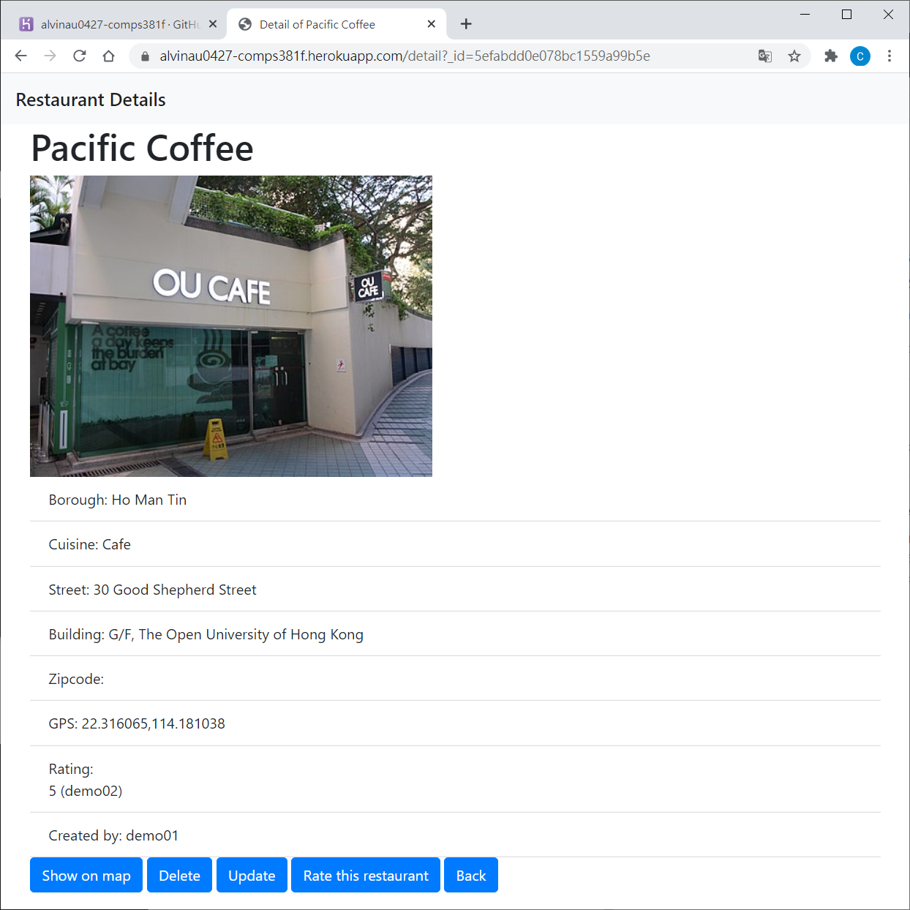

# COMPS381F-Assignment
> **OUHK 2019/20 Server-side Technologies and Cloud Computing (COMPS381F) Group Project**
>
> A robust Server-side web application built with **Node.js** and **Express**, featuring a full CRUD engine for restaurant data management, integrated with **MongoDB** and deployed on **Heroku**.

[](#) &nbsp;
[](#) &nbsp;
[](#) &nbsp;
[](#) &nbsp;
[](LICENSE) &nbsp;

## Project Overview
This project demonstrates the implementation of a modern Server-side architecture. It provides a complete administrative interface for managing a restaurant database, ensuring data persistence through cloud-hosted NoSQL storage.

### Core Architecture:
* **Backend:** Express.js framework handling RESTful routing and middleware.
* **Database:** MongoDB Atlas for flexible, document-based data storage.
* **View Engine:** EJS (Embedded JavaScript) for dynamic server-side rendering.
* **Authentication:** Secure user account creation and session management.

## Key Features
* **User System:** Personalized accounts for managing restaurant entries.
* **Full CRUD Lifecycle:** Create, Read, Update, and Delete restaurant records with ease.
* **Smart Rating System:** Integrated rating mechanism with logic to prevent duplicate voting (one vote per user per restaurant).
* **Advanced Search:** Real-time filtering and querying of the restaurant collection.
* **Cloud Deployment:** Fully containerized logic ready for Heroku deployment.

## Installation & Local Setup
### Prerequisites
* **Node.js** (v12.x or higher)
* **MongoDB** (Local instance or MongoDB Atlas URI)

### Setup Steps
1. **Clone the repository:**
   ```
   git clone <your-repo-url>
   cd COMPS381F-Assignment
   ```

2. **Install dependencies:**
   ```
   npm install
   ```

3. **Configure Environment:**
   Update your MongoDB connection string in the configuration file to point to your local or cloud database.

4. **Launch the Server:**
   ```
   npm start
   ```
   The application will be available at `localhost:8099`.

## Live Demonstration
The application is currently deployed on Heroku for public preview.
* **Deployment URL:** [View Project on Heroku](https://alvinau0427-comps381f.herokuapp.com/)
> [!IMPORTANT]
> **Demo Credentials**
> * **User IDs:** `demo01` / `demo02`
> * **Password:** *(No password required)*

## Screenshots


## License
- COMPS381F-Assignment is released under the [MIT License](https://opensource.org/licenses/MIT).
```
Copyright (c) 2020 alvinau0427

Permission is hereby granted, free of charge, to any person obtaining a copy
of this software and associated documentation files (the "Software"), to deal
in the Software without restriction, including without limitation the rights
to use, copy, modify, merge, publish, distribute, sublicense, and/or sell
copies of the Software, and to permit persons to whom the Software is
furnished to do so, subject to the following conditions:

The above copyright notice and this permission notice shall be included in all
copies or substantial portions of the Software.

THE SOFTWARE IS PROVIDED "AS IS", WITHOUT WARRANTY OF ANY KIND, EXPRESS OR
IMPLIED, INCLUDING BUT NOT LIMITED TO THE WARRANTIES OF MERCHANTABILITY,
FITNESS FOR A PARTICULAR PURPOSE AND NONINFRINGEMENT. IN NO EVENT SHALL THE
AUTHORS OR COPYRIGHT HOLDERS BE LIABLE FOR ANY CLAIM, DAMAGES OR OTHER
LIABILITY, WHETHER IN AN ACTION OF CONTRACT, TORT OR OTHERWISE, ARISING FROM,
OUT OF OR IN CONNECTION WITH THE SOFTWARE OR THE USE OR OTHER DEALINGS IN THE
SOFTWARE.
```
